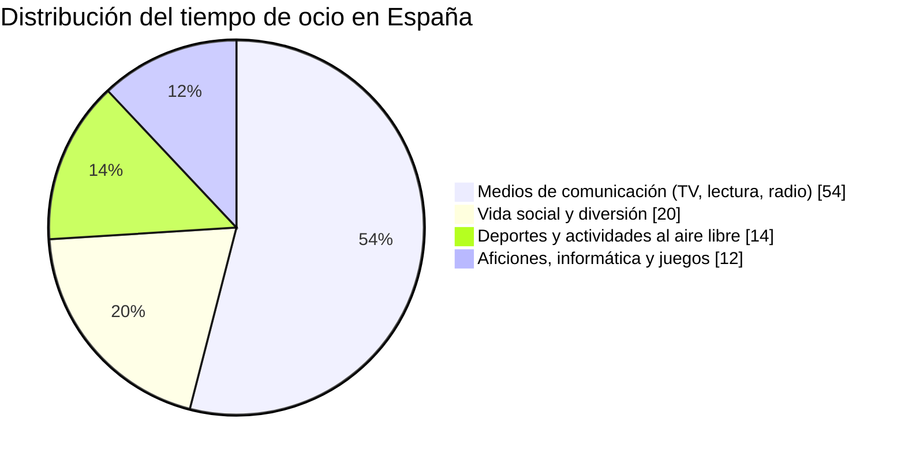

# Clase Tres - 16 de Noviembre del 2026

# Repaso

* LLM
  * Propietarios
    * ChatGPT
      * Redaccion con Lenguaje Natural
    * Claude
      * Tareas Tecnicas y Programacion
    * Gemini
      * Integracion con Ecosistema Google
      * Busqueda e investigacion Web
    * Copilot
      * Paredido a Gemini pero con el ecosistema 365
      * Apunta a corporaciones y proteccion de datos empresariales
    * Perplexity
      * Investigacioes Academicas
    * Grok
      * Tendendencias / Grounding en Redes
      * Baja censura
  * OS
    * Qwen
      * El ChatGPT OS (copia)
      * El estandar si queres instalar un modelo os local
    * Kimi
      * Similar a Claude con Enfoque Tecnico
    * DeepSeek
      * Modo pensado
    * Mistral
      * Enfoque a la legislacion Europea
* Comparar modelos
  * Arena.AI
    * Para estar actualizado en los modelos que salen
* Open Souce
  * Ejecucion Local
    * LMStudio (muy facil de de usar)
    * Ollama
  * Hugging Face (HF)
    * Listado de modelos
    * Codigo para usarlos en python
    * Spaces

---

# Prompt Engineerig

## Antomia de un prompt

Prompt = Tarea + Contexto + Rol + Ejemplo +  Formato + Tono

## Tips

* Usar la IA como experto en prompt engineerig
 * Le pongo el prompt como me sale y deje que la IA mejor

## Rol / Persona

* Objectivo
 * Decirle desde que lugar queremos que la IA nos de una resputesta

* Abrimos 4 solapas de ChatGPY
  * Prompt solo con la tarea (sin sol)
    * Promponeme un alrmuerzo para hoy. Dame una propuesta sin preguntar nada.
  * Con un rol especifico
    * Actua como una nutricionista especializado en salud y bienestar. Quiero que me propongas un almuerzo para hoy sin preguntar nada.
  * Desde la perspectiva de una persona conocida
   * Quiero que seas el Chef José Andrés y me propongas una comida para mi almuerzo.,
  * Citar un panel de expertos
   * Quero que me armes un panel de experto con distintos roles y que cada uno (maximo dos parrafos) me proponga una comida para hoy para mi almuerzo.

### Ejemplos

* Podemos ver algunos ejemplos en:
  * https://github.com/estebancalabria/Intro-Ia/tree/main/Prompt%20Engineering/Patrones%20de%20Prompting/Persona
* Por ejemplo

```
Quiero que actúes como una hoja de cálculo basada en texto. Solo responderás con una tabla de 10 filas, con los números de fila a la izquierda y las columnas de la A a la L. La primera celda de cada fila estará vacía para referenciar el número de fila. Te diré qué escribir en cada celda y tú solo me responderás con el resultado de la tabla, sin explicaciones. También te escribiré fórmulas, y tú me responderás solo con la tabla actualizada. Primero, respóndeme con una hoja vacía.
```

---

## Contexto 

* Contexto = Lo que escribis en el prompt + Toda la conversacion + Instrucciones Personaliadas + System Prompt + Memoria + Busqueda con Herramientas o busqueda web
* Muchas veces la IA me da mejores respuesta cuanta mas informacion tiene y es ahi donde resulta util aplicar el modo dictado y en vez de escribir prompts cortitos darle a la Ia todo el contexto para que trabaje

### Interaccion o Prompt Chainning (encadenamiento de prompts)

* Idea
  * Encadenar prompts generando una convesacion que tenga el contexto necesario antes de de pedirle la respuesta concreta de lo que quiero
 
* Interaccion
 * Le voy a pedir a la IA que me haga pregutnas "DE A UNA" para responder de forma mas precisa
 * Utlimamente los LLM a veces lo implementan sin que se lo ida

* Ejemplo

```
Dame una propuesta para comer hoy para mi almuerzo. Haceme pregutnas DE A UNA para obtener el contexto suficiente para encontrar la mejor propuesta de comida personalizada para mi."
```

---
# Break
HAsta y 15
---

### Planificar

* Idea
  * Antes de pedirle a la IA que me haga una tarea, que me responda la una planificacion
  * Antes de darela la tarea directamente, darle un espacio para pensar lo que va a hacer
 
* Sin plan
   * Redactame un plan de negocio para mi empresa de vender limonadas en la puerta de mi casa
   * https://chatgpt.com/share/6afb4d4b-c724-83e8-a60c-2c6700164ca5
* Con Plan
  * Planifica como vas a hacer un plan de negocio para mi empresa de vender limonadas en la puerta de mi casa. No generes el plan de negocios sino que quiero que planifiques y analices como hacerlo previamente
  * https://chatgpt.com/share/6afb4d5b-cbe0-83e9-b51c-fc102f2afa3a
  * Redactame el plan en base a tu planificacion

> [!NOTE]
> Se ve claramente que cuando le pido a la IA que planfique antes de darme una respuesta directamente 

----

## Formato de Salida

* Primero le voy a pedir a la IA una lista de algo sin formato

```
Dame una lista de los 10 libros que tengo que leer antes de morir indicando titulo, autor, fecha, longitud, tematica, argumento.
```

### Formatos tecnicos

* Para tener una reperesetnacion uniforme y estandar de la informacion
* Se utilizan mucho en sistemas
 * JSON
   * Dame la lista en json
   * Es muy imortante porque la IA usa muchisimo este  lenguaje por dentro
 * XML
   * Dame la lista en XML
 * Codigo
    * Javascript / Python

### Formatos pseudo tecnicos

* PDF
  * "Generame la lista en pdf"
  * Tenemos poco control o a veces requiere demasiadas interacciones sobre como se va a ver el resultado final
* HTML
  * Puedo usarlo sin conocer el lenguaje
  * Es el lenguaje con el que estan hecha las pagina web
  * Puedo generar pdf con mas control a partir del html
  * Me permiten salidas que puedo compartir porque se ven mas profesionales
* CSV
  * Generame la lista como csv
  * Comma separated Values
  * Con ese formato lo puedo abrir en excel
  * Tambien me sirve para guardar los excel como archivos CSV para parsarselos a la IA


---
# Break
Y 10 
---

## Markdown

* Es un lenguaje para darle formato la salida de forma sencilla
* La IA utiliza markdown por defecto aunque no nos demos cuenta
* Documentacion : https://es.wikipedia.org/wiki/Markdown

* Problemas qeu resuelve
  * Poder especificar el formato exacto de la salida mediante una plantilla

* Especificacion exacta como quiero la respuesta de acuerdo a esta plantilla

```

# [TITULO]

## Informacion General

* Fecha : [FECHA]
* **Autor** : [AUTOR] 
* Genero  : [GENERO]

## Argumento

> [EL ARGUMENTO DEL LIBRO]

## Personajes

1. [Personaje 1]
2. [Personaje 2]
...

---
```

## Mermaid

* Lenguaje para generar Diagramas
  * https://mermaid.live/
 
* Un Flowchart

```
Generame en mermaid un flowchart donde se vea el organigrama de Microsoft
```

* Hizo esto

```mermaid
flowchart TB
    SAT["Satya Nadella<br/>Chairman & CEO"]

    SAT --> COMM["Judson Althoff<br/>CEO Microsoft Commercial Business"]
    SAT --> CAI["Scott Guthrie<br/>EVP Cloud + AI Group"]
    SAT --> CFO["Amy Hood<br/>EVP & CFO"]
    SAT --> BRAD["Brad Smith<br/>Vice Chair & President"]
    SAT --> HR["Amy Coleman<br/>EVP & Chief Human Resources Officer"]
    SAT --> MKT["Takeshi Numoto<br/>EVP & Chief Marketing Officer"]

    COMM --> SALES["Ventas y negocio comercial"]
    COMM --> M365["Microsoft 365"]
    COMM --> AZURE["Soluciones empresariales"]
    COMM --> PARTNERS["Ecosistema de partners"]

    CAI --> AZ["Azure"]
    CAI --> AI["AI Platforms & Services"]
    CAI --> DEV["Developer Tools"]
    CAI --> DATA["Data & Cloud Infrastructure"]

    CFO --> FIN["Finanzas"]
    CFO --> IR["Investor Relations"]

    BRAD --> LEGAL["Legal & Corporate Affairs"]
    BRAD --> POLICY["Public Policy"]
    BRAD --> GOV["Gobierno y regulación"]

    HR --> PEOPLE["People & Culture"]
    HR --> TALENT["Talent Acquisition"]

    MKT --> BRAND["Brand & Communications"]
    MKT --> GTM["Marketing Strategy"]

    classDef ceo fill:#185ABD,color:#fff,stroke:#185ABD
    classDef executive fill:#dceafe,color:#172554,stroke:#2563eb
    classDef division fill:#f1f5f9,color:#1e293b,stroke:#94a3b8

    class SAT ceo
    class COMM,CAI,CFO,BRAD,HR,MKT executive
    class SALES,M365,AZURE,PARTNERS,AZ,AI,DEV,DATA,FIN,IR,LEGAL,POLICY,GOV,PEOPLE,TALENT,BRAND,GTM division
```



* Con este prompt

```
Haceme un diagrama de Pie en memaid donde se muestre el reparto de tiempo de ocio (cine, libros, etc) en la pobacion de Epania.
```

* Genero esto



---

# Proxima Clase

* Mencionar
  * Claude code y el pongo (Generacion de Codigo como Formato)
    * Agentes de codificacion y Vibe Coding
  * Otras alternativas para hacer Graficos con MatPlotLib
* Herramientas de IA
