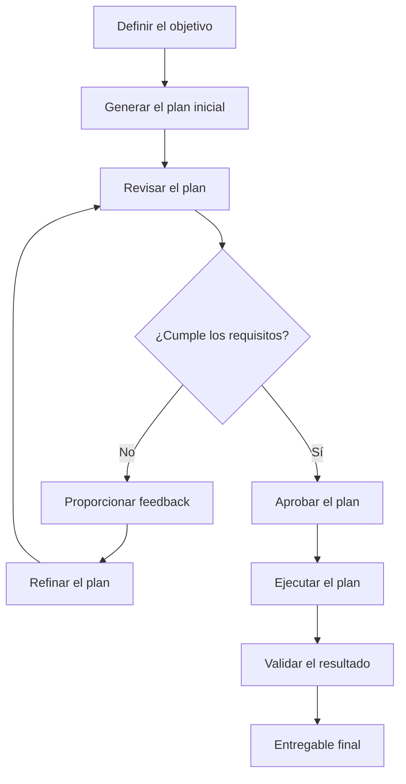

# Plan-and-Solve Prompting

Una técnica de prompting que mejora la resolución de problemas de múltiples pasos mediante una instrucción explícita: primero diseñar un plan y luego ejecutarlo.

Plan-and-Solve Prompting (PS) propone que los modelos de lenguaje de gran escala (LLMs) descompongan problemas complejos en subtareas más pequeñas, las organicen en una secuencia lógica y ejecuten el plan resultante.

Su variante extendida, Plan-and-Solve Plus (PS+), incorpora instrucciones más detalladas para mejorar la calidad de los pasos intermedios y reducir errores de cálculo.

Este repositorio explora los fundamentos académicos, la metodología, las variantes, la implementación práctica, los ejemplos, las limitaciones y las aplicaciones de Plan-and-Solve Prompting.

---

## Tabla de contenidos

1. [Introducción](#1-introducción)
2. [Origen y fundamentos académicos](#2-origen-y-fundamentos-académicos)
3. [Cómo funciona Plan-and-Solve Prompting](#3-cómo-funciona-plan-and-solve-prompting)
4. [Variantes: PS y PS+](#4-variantes-ps-y-ps)
5. [Implementación paso a paso](#5-implementación-paso-a-paso)
6. [Planificación iterativa y Human-in-the-Loop](#6-planificación-iterativa-y-human-in-the-loop)
7. [Ejemplos prácticos](#7-ejemplos-prácticos)
8. [Comparación con otras técnicas de prompting](#8-comparación-con-otras-técnicas-de-prompting)
9. [Buenas prácticas](#9-buenas-prácticas)
10. [Limitaciones y riesgos](#10-limitaciones-y-riesgos)
11. [Plantillas de prompts reutilizables](#11-plantillas-de-prompts-reutilizables)
12. [Investigación, benchmarks y evidencia experimental](#12-investigación-benchmarks-y-evidencia-experimental)
13. [Referencias y lecturas adicionales](#13-referencias-y-lecturas-adicionales)

---

# 1. Introducción

## ¿Qué es Plan-and-Solve Prompting?

Plan-and-Solve Prompting es una técnica de prompting Zero-Shot diseñada para mejorar la capacidad de los modelos de lenguaje de gran escala (LLMs) para resolver problemas que requieren múltiples pasos de razonamiento.

En lugar de pedirle directamente a un LLM que resuelva un problema, la técnica le indica explícitamente que:

1. Comprenda el problema.
2. Desarrolle un plan para resolverlo.
3. Divida el problema en subtareas más pequeñas.
4. Ejecute el plan paso a paso.
5. Produzca una respuesta final.

La idea central es sencilla:

**Primero planificar. Después resolver.**

El prompting tradicional suele pedirle al modelo que pase directamente del planteamiento del problema a la respuesta final. Esto puede generar pasos omitidos, análisis incompletos o errores en tareas que requieren múltiples operaciones.

Plan-and-Solve introduce una instrucción explícita de planificación para promover un proceso de resolución más estructurado.

## ¿Por qué es útil?

Las tareas complejas suelen requerir varias operaciones que dependen unas de otras.

Por ejemplo, analizar un problema empresarial puede requerir:

- Comprender el contexto del negocio.
- Identificar la información relevante.
- Definir el problema.
- Evaluar posibles soluciones.
- Comparar alternativas.
- Recomendar un enfoque.

Si el modelo intenta resolver todo simultáneamente, puede pasar por alto pasos importantes.

Plan-and-Solve lo incentiva a establecer una secuencia de operaciones antes de intentar resolver el problema.

## Principio fundamental

La técnica introduce una distinción entre dos actividades complementarias:

| Actividad | Propósito |
|---|---|
| Planificación (Planning) | Determinar qué hay que hacer y en qué orden. |
| Resolución (Solving) | Ejecutar los pasos planificados y producir la solución. |

Esta separación puede mejorar la organización de las tareas, especialmente cuando los problemas incluyen múltiples dependencias o cálculos intermedios.

---

# 2. Origen y fundamentos académicos

## La investigación original

Plan-and-Solve Prompting fue presentado por Lei Wang, Wanyu Xu, Yihuai Lan, Zhiqiang Hu, Yunshi Lan, Roy Ka-Wei Lee y Ee-Peng Lim.

La técnica fue publicada en 2023 durante la 61.ª edición de la conferencia anual de la Association for Computational Linguistics (ACL).

**Artículo original:**

*Plan-and-Solve Prompting: Improving Zero-Shot Chain-of-Thought Reasoning by Large Language Models.*

Autores: Lei Wang et al.

Publicación: ACL 2023, Long Papers, páginas 2609–2634.

- [ACL Anthology – Artículo original](https://aclanthology.org/2023.acl-long.147/)
- [arXiv – Investigación completa](https://arxiv.org/abs/2305.04091)
- [GitHub – Implementación de los autores](https://github.com/AGI-Edgerunners/Plan-and-Solve-Prompting)

## El problema que aborda la investigación

La investigación se apoya en Chain-of-Thought (CoT) y Zero-Shot Chain-of-Thought.

Zero-Shot CoT demostró que agregar una instrucción sencilla como:

"Let's think step by step."

podía mejorar el rendimiento de los LLMs en tareas de razonamiento con múltiples pasos.

Sin embargo, los investigadores identificaron tres categorías de errores:

**1. Errores de cálculo (Calculation Errors)**

El modelo realiza cálculos incorrectos o produce resultados numéricos intermedios equivocados.

**2. Errores por omisión de pasos (Missing-Step Errors)**

El modelo omite operaciones intermedias importantes para resolver el problema.

**3. Errores de interpretación semántica (Semantic Misunderstanding Errors)**

El modelo interpreta incorrectamente el problema o no comprende las relaciones entre la información proporcionada.

Los investigadores propusieron Plan-and-Solve para abordar los errores por omisión de pasos mediante una instrucción explícita que solicita diseñar un plan antes de resolver el problema.

PS+ amplía este enfoque con instrucciones adicionales para mejorar los cálculos intermedios y la calidad de los pasos generados.

## Relación con Chain-of-Thought

Plan-and-Solve pertenece a la familia de técnicas de prompting relacionadas con Chain-of-Thought.

Sin embargo, existe una diferencia importante:

- Zero-Shot CoT incentiva al modelo a generar pasos intermedios de razonamiento.
- Plan-and-Solve incentiva explícitamente al modelo a construir un plan antes de ejecutar esos pasos.

La diferencia no consiste simplemente en pedirle al modelo que explique su respuesta, sino en introducir una estrategia explícita de planificación y descomposición de tareas.

---

# 3. Cómo funciona Plan-and-Solve Prompting

El enfoque original de Plan-and-Solve tiene dos componentes fundamentales.

## Etapa 1: Planificación (Planning)

El modelo recibe el problema y debe comprenderlo y desarrollar un plan.

Durante esta etapa, debería identificar:

- El objetivo principal.
- La información relevante.
- Las operaciones necesarias.
- Las subtareas intermedias.
- La secuencia lógica de las operaciones.

El objetivo es establecer un enfoque estructurado antes de resolver el problema.

**Ejemplo:**

Una empresa tiene 250 empleados. El 40 % trabaja en operaciones, el 35 % en administración y el resto en tecnología.

¿Cuántos empleados trabajan en tecnología?

**Planificación:**

1. Identificar el número total de empleados.
2. Calcular cuántos trabajan en operaciones.
3. Calcular cuántos trabajan en administración.
4. Sumar los empleados de ambos departamentos.
5. Restar ese total del número general de empleados.

El modelo ya estableció la secuencia de operaciones necesaria para resolver el problema.

## Etapa 2: Resolución (Solving)

Una vez establecido el plan, el modelo ejecuta las operaciones necesarias.

Utilizando el ejemplo anterior:

- Total de empleados: 250.
- Operaciones: 250 × 0,40 = 100.
- Administración: 250 × 0,35 = 87,5.
- Total combinado: 100 + 87,5 = 187,5.
- Tecnología: 250 − 187,5 = 62,5.

**Importante:** Este ejemplo también demuestra por qué la validación es necesaria. Los resultados representan cantidades fraccionarias de empleados, algo inconsistente con el contexto de personas enteras. El modelo debería señalar esta inconsistencia en lugar de presentar silenciosamente 62,5 empleados como un resultado empresarial válido.

El plan ayuda a organizar las operaciones, pero no garantiza que los supuestos o los cálculos sean correctos.

## Estructura del prompt original

La instrucción original de PS es:

```text
Let's first understand the problem and devise a plan
to solve the problem. Then, let's carry out the plan
to solve the problem step by step.
```

Esta modificación sencilla es la base de la técnica.

---

# 4. Variantes: PS y PS+

La investigación original presentó dos versiones de la técnica.

## 4.1. Plan-and-Solve (PS)

PS indica al modelo que:

1. Comprenda el problema.
2. Diseñe un plan.
3. Ejecute el plan paso a paso.

Su objetivo principal es reducir los errores por omisión de pasos.

**Prompt original de PS:**

```text
Let's first understand the problem and devise a plan
to solve the problem. Then, let's carry out the plan
to solve the problem step by step.
```

## 4.2. Plan-and-Solve Plus (PS+)

PS+ amplía el prompt original con instrucciones más detalladas.

Incentiva al modelo a:

- Extraer las variables relevantes.
- Identificar los valores numéricos correspondientes.
- Desarrollar un plan completo.
- Calcular resultados intermedios.
- Prestar atención a la precisión numérica.
- Considerar el sentido común al resolver el problema.
- Presentar la respuesta final.

**Prompt original de PS+:**

```text
Let's first understand the problem, extract relevant
variables and their corresponding numerals, and
devise a plan.

Then, let's carry out the plan, calculate intermediate
variables (pay attention to correct numeral calculation
and commonsense), solve the problem step by step,
and show the answer.
```

## 4.3. PS vs. PS+

| Característica | PS | PS+ |
|---|---|---|
| Comprensión del problema | Sí | Sí |
| Planificación explícita | Sí | Sí |
| Descomposición de tareas | Sí | Sí |
| Extracción explícita de variables | No es un requisito explícito | Sí |
| Cálculos intermedios | No es un requisito explícito | Sí |
| Instrucciones sobre precisión numérica | Generales | Más detalladas |
| Consideraciones de sentido común | Generales | Explícitas |

## ¿Cuándo utilizar cada variante?

**Utilizar PS cuando:**

- La tarea requiere múltiples pasos.
- El problema involucra descomposición lógica.
- El modelo necesita establecer una secuencia de ejecución.
- La tarea no depende principalmente de cálculos numéricos.

**Utilizar PS+ cuando:**

- La tarea involucra razonamiento numérico.
- Es necesario identificar variables y valores.
- Los cálculos intermedios son importantes.
- El problema requiere especial atención a la consistencia numérica y al sentido común.

PS+ no es necesariamente superior para todas las tareas. Sus instrucciones adicionales son particularmente relevantes para los tipos de errores que busca abordar.

---

# 5. Implementación paso a paso

Plan-and-Solve puede implementarse utilizando un prompt relativamente sencillo.

Sin embargo, su efectividad depende en gran medida de la claridad con la que se define la tarea.

## Paso 1: Definir el objetivo

Comenzar describiendo qué se espera que realice el modelo.

Evitar instrucciones ambiguas.

**Prompt débil:**

```text
Analyze this company.
```

**Prompt mejorado:**

```text
Analyze the operational efficiency of a logistics company
with 500 employees and identify the three most significant
opportunities to reduce operating costs.
```

Un objetivo bien definido proporciona una base más clara para la planificación.

## Paso 2: Solicitar un plan

Indicar explícitamente al modelo que desarrolle un plan antes de resolver el problema.

```text
Before executing the task, analyze the objective and
develop a structured plan.

Break the problem into smaller subtasks and organize
them in a logical sequence.

Do not execute the plan yet.
```

## Paso 3: Revisar el plan

Comprobar si el plan propuesto:

- Responde al objetivo original.
- Incluye todas las operaciones relevantes.
- Sigue una secuencia lógica.
- Considera las restricciones.
- Identifica información faltante.
- Evita pasos innecesarios.

## Paso 4: Ejecutar el plan

Una vez que el plan esté definido, solicitar al modelo que lo ejecute.

```text
Execute the approved plan.

Follow the established sequence and address each
subtask.

If you encounter missing information, assumptions,
or inconsistencies, identify them instead of
inventing information.

Present the final result in a structured format.
```

## Paso 5: Validar el resultado

Revisar el resultado final en función del objetivo original.

Considerar:

- Integridad.
- Precisión.
- Consistencia.
- Cumplimiento de restricciones.
- Calidad del entregable final.

La planificación y la validación son actividades complementarias. Ninguna garantiza por sí sola que el modelo produzca un resultado correcto.

---

# 6. Planificación iterativa y Human-in-the-Loop

Una extensión práctica interesante de Plan-and-Solve consiste en introducir una etapa explícita de revisión y refinamiento antes de ejecutar el plan.

Este enfoque resulta especialmente útil en entornos profesionales, donde la calidad del plan puede ser tan importante como el entregable final.

En lugar de aceptar el primer plan generado por el modelo, el usuario participa activamente en su mejora.

## Flujo de planificación iterativa

El flujo consta de seis etapas:

### Etapa 1: Generar el plan inicial

Solicitar al modelo que analice la tarea y proponga un plan estructurado.

### Etapa 2: Revisar el plan

Examinar los pasos propuestos e identificar:

- Actividades faltantes.
- Supuestos incorrectos.
- Complejidad innecesaria.
- Dependencias no contempladas.
- Riesgos potenciales.

### Etapa 3: Refinar el plan

Solicitar al modelo que modifique su propuesta a partir de las observaciones del usuario.

### Etapa 4: Repetir el proceso

Continuar revisando y refinando hasta que el plan cumpla con los criterios establecidos.

### Etapa 5: Aprobar el plan

Aprobar explícitamente la versión definitiva.

### Etapa 6: Ejecutar

Una vez aprobado, solicitar al modelo que ejecute el plan.

## Diagrama del flujo de trabajo



## Ejemplo: Refinamiento de un plan de análisis empresarial

**Solicitud inicial:**

```text
I want to analyze the profitability of a company
and identify opportunities for improvement.

Before performing the analysis, create a detailed plan.
Do not execute it yet.
```

**Plan inicial generado por el modelo:**

1. Recopilar información sobre ingresos.
2. Identificar gastos operativos.
3. Calcular rentabilidad.
4. Identificar oportunidades de mejora.
5. Preparar recomendaciones.

**Feedback del usuario:**

```text
The plan is too generic.

Add the following elements:

- Analyze profitability by business unit.
- Compare performance across the last three years.
- Identify fixed and variable costs.
- Calculate gross margin and operating margin.
- Identify potential operational inefficiencies.
- Distinguish findings supported by data from assumptions.

Revise the plan without executing it.
```

**Plan refinado:**

El modelo incorpora los requisitos adicionales y genera una secuencia de actividades más detallada.

**Instrucción final:**

```text
I approve this plan.

Execute it using the available information.
Clearly identify missing data and assumptions.
Do not invent financial figures.
```

## ¿Por qué es útil esta extensión?

Introduce una distinción importante entre generar un plan y aceptar un plan.

El usuario conserva la responsabilidad de:

- Definir el objetivo.
- Establecer restricciones.
- Revisar el enfoque propuesto.
- Corregir interpretaciones incorrectas.
- Aprobar la ejecución.

Esto permite establecer una colaboración más controlada entre el usuario y la IA.

**Nota terminológica:** PS y PS+ en su formulación académica original no requieren una etapa independiente de aprobación humana ni revisiones iterativas del plan. El flujo iterativo descrito aquí es una adaptación práctica basada en el principio original de planificación.

---

# 7. Ejemplos prácticos

Los siguientes ejemplos muestran cómo adaptar Plan-and-Solve a diferentes escenarios profesionales.

## 7.1. Razonamiento matemático

**Objetivo:** Resolver un problema matemático de múltiples pasos.

**Prompt:**

```text
A company purchases 120 laptops at $850 each.

The supplier offers a 12% discount on the total purchase.
The company must also pay 8% in import duties calculated
on the discounted purchase value.

Calculate the final cost of the purchase.

Use Plan-and-Solve Plus:

1. Identify all relevant variables and values.
2. Develop a complete calculation plan.
3. Calculate each intermediate result.
4. Apply the correct calculation sequence.
5. Verify the final result.
6. Present the answer with the calculation details.
```

**Cálculo esperado:**

- Compra inicial: 120 × 850 = USD 102.000.
- Descuento: 102.000 × 0,12 = USD 12.240.
- Valor con descuento: USD 89.760.
- Derechos de importación: 89.760 × 0,08 = USD 7.180,80.
- Costo final: USD 96.940,80.

**Resultado esperado:** USD 96.940,80.

## 7.2. Análisis empresarial

**Objetivo:** Identificar oportunidades para mejorar la eficiencia operativa.

**Prompt:**

```text
You are analyzing the operational performance
of a logistics company.

The company has experienced a 15% increase in
operating costs over the last 12 months.

Before performing the analysis:

1. Understand the business problem.
2. Develop a structured investigation plan.
3. Identify the information required.
4. Define the metrics needed.
5. Identify potential causes to investigate.
6. Establish how findings will be validated.

Do not execute the analysis yet.
Present the proposed plan for review.
```

El usuario puede refinar el plan antes de proporcionar los datos operativos disponibles y autorizar el análisis.

## 7.3. Planificación de proyectos

**Objetivo:** Desarrollar un plan de implementación para una migración a Microsoft Azure.

**Prompt:**

```text
We need to migrate an organization's on-premises
infrastructure to Microsoft Azure.

The organization has:

- 80 virtual machines.
- 3 SQL Server databases.
- 2 on-premises Active Directory environments.
- Several business-critical applications.
- A limited maintenance window.

Create a comprehensive migration plan.

Before proposing execution activities:

1. Identify the main migration phases.
2. Identify technical dependencies.
3. Identify security considerations.
4. Define risk assessment activities.
5. Establish testing and validation requirements.
6. Identify rollback considerations.

Do not assume that all workloads are suitable
for direct migration.

Present the plan for review.
```

Este ejemplo demuestra cómo la técnica puede ayudar a estructurar proyectos técnicos complejos.

## 7.4. Análisis de datos

**Objetivo:** Analizar el rendimiento de ventas.

**Prompt:**

```text
I have a dataset containing three years of sales data.

The dataset includes:

- Transaction date.
- Product category.
- Region.
- Sales representative.
- Revenue.
- Units sold.
- Discounts.

Before analyzing the dataset, create a plan.

Include:

1. Data quality assessment.
2. Missing value identification.
3. Data cleaning requirements.
4. Revenue and sales trend analysis.
5. Regional performance comparison.
6. Product category analysis.
7. Identification of potential anomalies.
8. Recommendations based on the findings.

Do not execute the analysis yet.
```

El plan puede refinarse antes de procesar el conjunto de datos.

## 7.5. Desarrollo de software

**Objetivo:** Desarrollar una API REST.

**Prompt:**

```text
I need to develop a REST API for an inventory
management application using Python and FastAPI.

The API must support:

- Product creation.
- Product updates.
- Product deletion.
- Inventory queries.
- Authentication.
- Input validation.
- Error handling.

Before writing any code:

1. Analyze the requirements.
2. Identify the main components.
3. Propose the project architecture.
4. Define the API endpoints.
5. Identify the data model.
6. Define security requirements.
7. Establish testing requirements.

Present the implementation plan.
Do not generate the code yet.
```

Este enfoque permite identificar decisiones arquitectónicas antes de comenzar a generar código.

## 7.6. Automatización de procesos empresariales

**Objetivo:** Automatizar el procesamiento de facturas.

**Prompt:**

```text
We need to automate the processing of supplier invoices.

The process currently involves:

- Receiving invoices by email.
- Extracting invoice information.
- Validating supplier details.
- Comparing invoice values against purchase orders.
- Identifying discrepancies.
- Sending approved invoices for processing.

Develop an automation plan.

Identify:

1. Process stages.
2. Required data.
3. Validation rules.
4. Exception handling.
5. Human approval points.
6. Security considerations.
7. Integration requirements.
8. Testing and monitoring requirements.

Do not design the automation yet.
First present the proposed plan for review.
```

---

# 8. Comparación con otras técnicas de prompting

Plan-and-Solve está relacionado con diferentes enfoques de prompting, pero cada técnica enfatiza un aspecto distinto de la resolución de problemas.

| Técnica | Principio principal | Enfoque |
|---|---|---|
| Zero-Shot Prompting | Dar una instrucción sin proporcionar ejemplos. | Ejecución directa de tareas |
| Few-Shot Prompting | Proporcionar ejemplos del resultado esperado. | Demostración de patrones |
| Chain-of-Thought | Incentivar pasos intermedios de razonamiento. | Razonamiento de múltiples pasos |
| Zero-Shot CoT | Promover razonamiento paso a paso sin ejemplos. | Razonamiento estructurado |
| Plan-and-Solve | Diseñar un plan y luego ejecutarlo. | Planificación y descomposición |
| Least-to-Most | Resolver primero los subproblemas más sencillos. | Resolución progresiva |
| Prompt Chaining | Conectar múltiples prompts y resultados intermedios. | Flujos de trabajo por etapas |
| Decomposition Prompting | Dividir tareas complejas en componentes menores. | Descomposición de tareas |
| Tree of Thoughts | Explorar diferentes caminos de razonamiento. | Exploración de soluciones alternativas |

## 8.1. Plan-and-Solve vs. Chain-of-Thought

Chain-of-Thought incentiva la generación de pasos intermedios de razonamiento.

Plan-and-Solve agrega una instrucción explícita de planificación antes de resolver el problema.

**Diferencia principal:**

CoT se enfoca en el razonamiento intermedio.

PS introduce explícitamente la planificación y la descomposición de tareas.

## 8.2. Plan-and-Solve vs. Prompt Chaining

Estas técnicas pueden complementarse, pero no son intercambiables.

Prompt Chaining conecta múltiples prompts, donde el resultado de uno se convierte en la entrada del siguiente.

Plan-and-Solve es una estrategia de prompting que incentiva la planificación antes de la ejecución.

**Ejemplo de Prompt Chaining:**

```text
Prompt 1: Analyze the requirements.

Prompt 2: Use the analysis to design the solution.

Prompt 3: Use the design to implement the solution.
```

**Ejemplo de Plan-and-Solve:**

```text
First, understand the complete task and develop
a structured plan.

Then, execute the plan step by step.
```

Prompt Chaining se enfoca en conectar las etapas de un flujo de trabajo, mientras que Plan-and-Solve se enfoca en planificar el proceso de resolución.

También pueden combinarse: un prompt puede generar el plan, otro revisarlo y los siguientes ejecutar sus distintas etapas.

## 8.3. Plan-and-Solve vs. Least-to-Most Prompting

Least-to-Most Prompting descompone un problema complejo en subproblemas más sencillos y los resuelve progresivamente.

Plan-and-Solve solicita explícitamente un plan antes de ejecutar la tarea.

Ambos enfoques utilizan descomposición, pero enfatizan diferentes estrategias de ejecución.

## 8.4. Plan-and-Solve vs. Tree of Thoughts

Tree of Thoughts explora múltiples caminos posibles de razonamiento en lugar de depender de una única secuencia.

Plan-and-Solve generalmente establece un plan propuesto y lo sigue.

Tree of Thoughts resulta especialmente relevante cuando un problema requiere explorar y comparar diferentes enfoques.

---

# 9. Buenas prácticas

## 9.1. Definir objetivos claros

La calidad del plan depende en gran medida de la claridad de la tarea original.

Especificar:

- Resultado deseado.
- Contexto.
- Restricciones.
- Información disponible.
- Entregable esperado.

## 9.2. Solicitar planificación explícita

No asumir que el modelo generará automáticamente un plan útil.

Utilizar instrucciones explícitas como:

```text
Before executing the task, develop a structured plan.
Break the task into smaller subtasks and organize
them in a logical sequence.
```

## 9.3. Definir restricciones

Especificar los límites importantes.

Por ejemplo:

- Restricciones presupuestarias.
- Limitaciones de tiempo.
- Recursos disponibles.
- Requisitos técnicos.
- Restricciones regulatorias.
- Políticas organizacionales.

## 9.4. Identificar dependencias

Algunas tareas no pueden realizarse hasta que otras hayan sido completadas.

Solicitar al modelo que identifique las dependencias y explique el orden de ejecución.

## 9.5. Establecer criterios de aceptación

Definir cómo se evaluará el resultado final.

Por ejemplo:

```text
The final deliverable must:

- Address all requirements.
- Include supporting calculations.
- Identify assumptions.
- Follow the defined constraints.
- Provide actionable recommendations.
```

## 9.6. Evitar complejidad innecesaria

Un plan debe tener suficiente detalle para orientar la ejecución, pero no tanto como para convertirse en un obstáculo.

El nivel de descomposición adecuado depende de la complejidad de la tarea.

## 9.7. Validar la información crítica

Nunca asumir que un plan bien estructurado garantiza la precisión.

Verificar cálculos, afirmaciones factuales, decisiones técnicas y supuestos.

---

# 10. Limitaciones y riesgos

Plan-and-Solve puede mejorar la organización de las tareas, pero no elimina las limitaciones de los modelos de lenguaje.

## 10.1. Planes incorrectos

El modelo puede interpretar incorrectamente el objetivo y generar un plan que no resuelva el problema real.

## 10.2. Información faltante

Un plan puede omitir requisitos, restricciones o dependencias relevantes.

## 10.3. Errores de ejecución

Incluso cuando el plan es correcto, el modelo puede cometer errores al ejecutar los pasos individuales.

## 10.4. Supuestos incorrectos

Los modelos pueden introducir supuestos que no están respaldados por la información disponible.

## 10.5. Planificación excesiva

Las tareas sencillas no necesariamente se benefician de una planificación explícita.

Incorporar etapas innecesarias puede aumentar la latencia, el consumo de tokens y la complejidad.

## 10.6. Sin garantía de corrección

Un plan estructurado no demuestra que el resultado final sea correcto.

La validación independiente sigue siendo importante, especialmente en aplicaciones financieras, legales, médicas, de seguridad y otros contextos de alto impacto.

## 10.7. Supervisión humana

En tareas empresariales críticas, los usuarios deben revisar las decisiones importantes y conservar el control sobre las acciones que requieren autorización.

---

# 11. Plantillas de prompts reutilizables

Las siguientes plantillas pueden adaptarse a diferentes tareas y contextos profesionales.

## Plantilla 1: Plan-and-Solve básico

```text
I need you to solve the following problem:

[PROBLEM DESCRIPTION]

First, understand the problem and develop
a structured plan to solve it.

Break the problem into smaller subtasks
and organize them in a logical sequence.

Then, execute the plan step by step.

Present the final result clearly.
```

## Plantilla 2: Plan-and-Solve Plus

```text
I need you to solve the following problem:

[PROBLEM DESCRIPTION]

First:

1. Understand the problem.
2. Identify relevant variables and information.
3. Extract numerical values where applicable.
4. Develop a complete plan.
5. Identify intermediate calculations.

Then:

1. Execute the plan.
2. Calculate intermediate results.
3. Pay attention to numerical accuracy.
4. Consider relevant commonsense constraints.
5. Verify the result.
6. Present the final answer.

Clearly identify assumptions and missing information.
```

## Plantilla 3: Planificación previa con aprobación humana

```text
I need you to complete the following task:

[TASK DESCRIPTION]

Do not execute the task immediately.

First, analyze the objective and develop
a detailed execution plan.

The plan must include:

- Main objectives.
- Subtasks.
- Execution sequence.
- Dependencies.
- Required resources.
- Potential risks.
- Expected deliverables.
- Acceptance criteria.

Present the plan for review.

Do not execute anything until I explicitly
approve the plan.
```

## Plantilla 4: Refinamiento iterativo del plan

```text
Review the current plan:

[CURRENT PLAN]

Evaluate it against the following requirements:

[REQUIREMENTS]

Identify:

- Missing steps.
- Incorrect assumptions.
- Unnecessary activities.
- Dependencies that have not been considered.
- Potential risks.
- Areas requiring clarification.

Propose an improved version.

Do not execute the plan yet.
```

## Plantilla 5: Revisión y validación del plan

```text
Act as an independent reviewer.

Evaluate the following plan:

[PLAN]

Assess:

1. Completeness.
2. Logical consistency.
3. Dependencies.
4. Feasibility.
5. Resource requirements.
6. Risks.
7. Alignment with the original objective.

Identify weaknesses and recommend improvements.

Do not assume the plan is correct simply
because it was previously generated.
```

## Plantilla 6: Ejecución de un plan aprobado

```text
I approve the following plan:

[APPROVED PLAN]

Execute the plan in the established sequence.

For each stage:

- Complete the required activities.
- Report relevant results.
- Identify assumptions.
- Highlight missing information.
- Validate critical outputs.

Do not silently change the approved scope.

If an important issue requires modifying the plan,
stop and request clarification.

Present the final deliverable.
```

---

# 12. Investigación, benchmarks y evidencia experimental

## Evaluación de la investigación original

El artículo original evaluó Plan-and-Solve utilizando GPT-3 en diez conjuntos de datos que cubrían tres categorías de problemas de razonamiento.

### Razonamiento matemático

La evaluación incluyó:

- AQuA
- GSM8K
- MultiArith
- AddSub
- SingleEq
- SVAMP

### Razonamiento de sentido común

- CommonsenseQA
- StrategyQA

### Razonamiento simbólico

- Last Letter
- Coin Flip

## Resultados reportados

Los investigadores informaron que sus enfoques Plan-and-Solve Zero-Shot superaron consistentemente a Zero-Shot CoT en los conjuntos de datos evaluados.

También reportaron:

- Rendimiento comparable o superior a Zero-Shot Program-of-Thought en los escenarios evaluados.
- Rendimiento de PS+ comparable al de Chain-of-Thought con ocho ejemplos (*8-shot CoT*) en tareas de razonamiento matemático.

Estos resultados proporcionan evidencia experimental a favor de las instrucciones explícitas de planificación en los escenarios estudiados.

**Limitaciones importantes al interpretar los resultados:**

- Los experimentos utilizaron modelos de la generación GPT-3.
- Los resultados se obtuvieron con conjuntos de datos y formulaciones específicas.
- Los hallazgos no demuestran que PS+ supere a todas las técnicas modernas de prompting ni a todos los LLM actuales.
- El rendimiento puede variar según la arquitectura del modelo, la complejidad de la tarea, la formulación del prompt y la metodología de evaluación.

## Implementación de la investigación

Los autores publicaron una implementación que contiene los prompts originales y las configuraciones experimentales.

Repositorio:

https://github.com/AGI-Edgerunners/Plan-and-Solve-Prompting

El repositorio incluye variantes de prompts identificadas como:

- Prompt 101: Chain-of-Thought.
- Prompt 201: Plan-and-Solve.
- Prompt 301: Plan-and-Solve Plus.

Consultar la implementación original para obtener las configuraciones experimentales exactas y los detalles necesarios para reproducir los resultados.

---

# 13. Referencias y lecturas adicionales

## Investigación principal

**Wang, L., Xu, W., Lan, Y., Hu, Z., Lan, Y., Lee, R. K.-W., & Lim, E.-P. (2023).**

*Plan-and-Solve Prompting: Improving Zero-Shot Chain-of-Thought Reasoning by Large Language Models.*

Proceedings of the 61st Annual Meeting of the Association for Computational Linguistics, páginas 2609–2634.

- [ACL Anthology](https://aclanthology.org/2023.acl-long.147/)
- [arXiv](https://arxiv.org/abs/2305.04091)
- [Repositorio oficial de GitHub](https://github.com/AGI-Edgerunners/Plan-and-Solve-Prompting)

## Investigaciones relacionadas

**Chain-of-Thought Prompting**

Wei et al. (2022).

*Chain-of-Thought Prompting Elicits Reasoning in Large Language Models.*

https://arxiv.org/abs/2201.11903

**Zero-Shot Chain-of-Thought**

Kojima et al. (2022).

*Large Language Models are Zero-Shot Reasoners.*

https://arxiv.org/abs/2205.11916

**Least-to-Most Prompting**

Zhou et al. (2022).

*Least-to-Most Prompting Enables Complex Reasoning in Large Language Models.*

https://arxiv.org/abs/2205.10625

**Tree of Thoughts**

Yao et al. (2023).

*Tree of Thoughts: Deliberate Problem Solving with Large Language Models.*

https://arxiv.org/abs/2305.10601

**Understanding Chain-of-Thought Prompting**

Wang et al. (2023).

*Towards Understanding Chain-of-Thought Prompting: An Empirical Study of What Matters.*

https://aclanthology.org/2023.acl-long.153/

## Recursos adicionales

- [Learn Prompting – Plan-and-Solve](https://learnprompting.org/docs/advanced/decomposition/plan_and_solve)
- [Código oficial de la investigación](https://github.com/AGI-Edgerunners/Plan-and-Solve-Prompting)

---

# Conclusión

Plan-and-Solve Prompting introduce una mejora importante en el prompting Zero-Shot convencional: solicitar explícitamente a un LLM que desarrolle un plan antes de intentar resolver un problema.

Su formulación original consta de dos componentes:

**Planificación → Resolución**

La variante PS+ amplía este enfoque con instrucciones más detalladas para identificar variables, calcular resultados intermedios y mejorar la calidad de las soluciones generadas.

En aplicaciones prácticas, este principio puede extenderse mediante planificación iterativa y revisión humana:

**Definir → Planificar → Revisar → Refinar → Aprobar → Ejecutar → Validar**

Este flujo extendido resulta particularmente útil para trabajar con problemas empresariales complejos, proyectos técnicos, análisis de datos, desarrollo de software y automatización de procesos.

La lección más amplia es que el uso efectivo de la IA no consiste únicamente en escribir mejores instrucciones. También implica estructurar el trabajo, evaluar el enfoque propuesto y mantener el control sobre el proceso de ejecución.

**Planificar antes de ejecutar. Validar antes de confiar en el resultado.**

